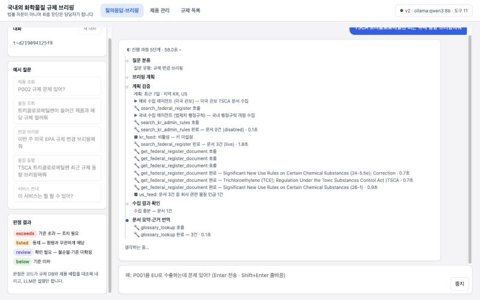
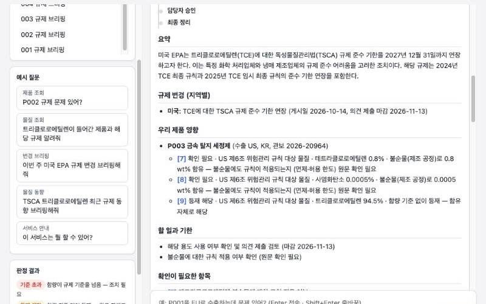
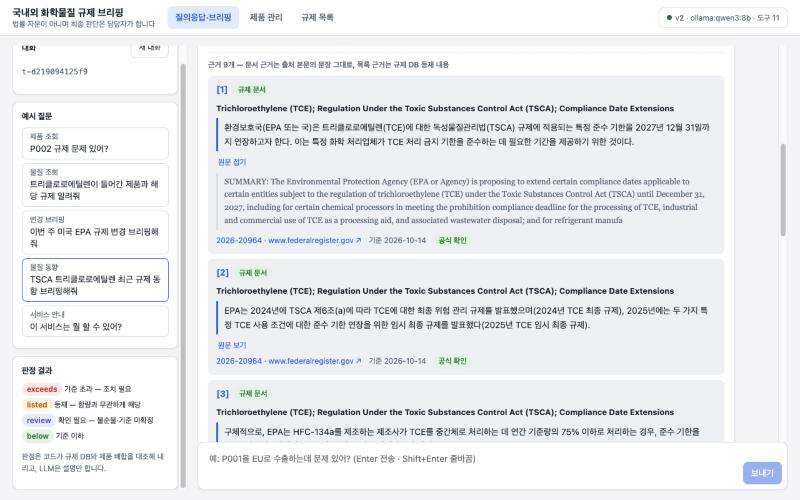
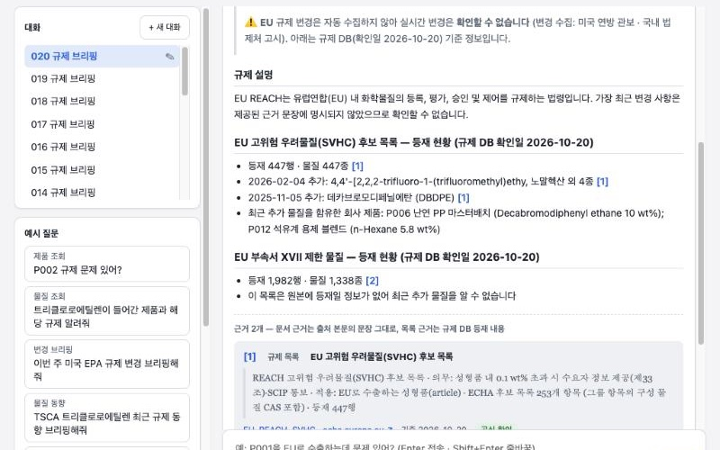
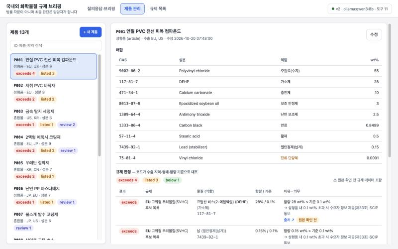
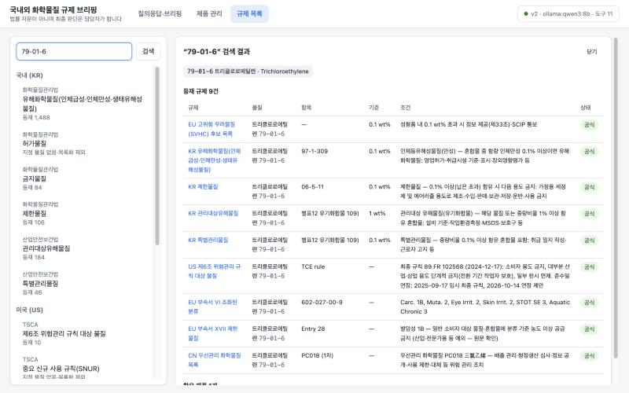
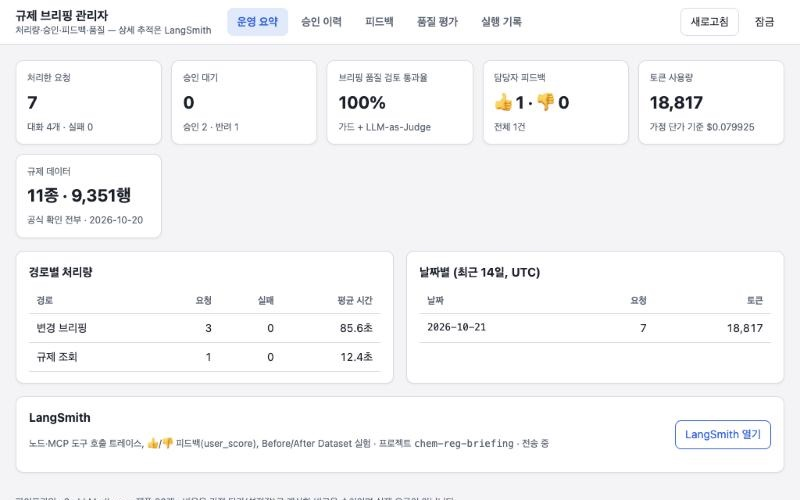
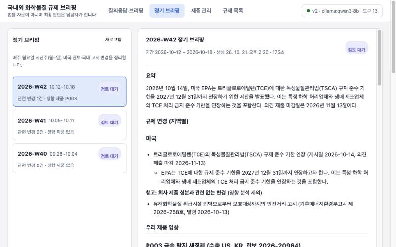
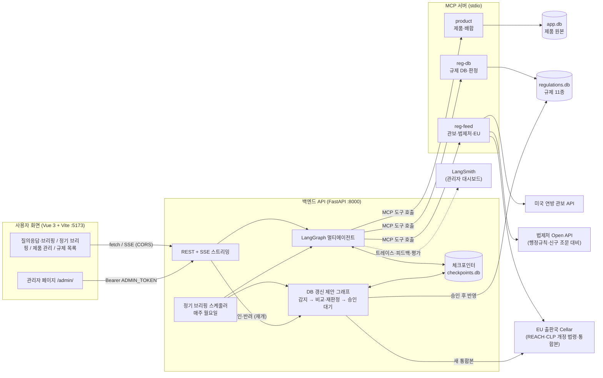
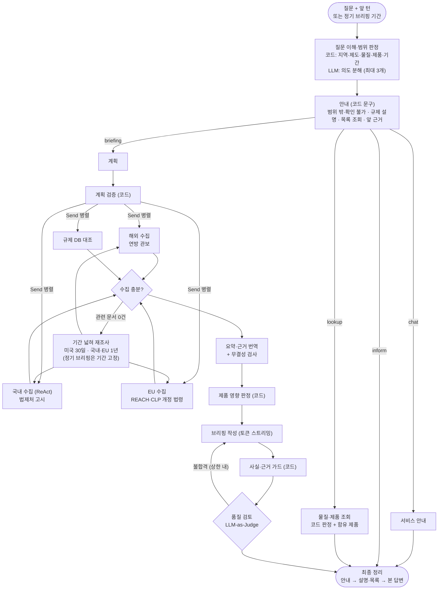

# 국내외 화학물질 규제 브리핑·영향 분석 에이전트

국내외 화학물질 규제 문서를 모아 한국어로 브리핑하고, 회사 제품 배합(CAS·함량)과 대조해 **어느 제품이 어떤 규제에 왜 해당하는지**를 근거 원문과 함께 알려 주는 멀티에이전트 서비스입니다.

> 판정은 코드가 내리고, LLM은 요약·번역·설명만 맡습니다. 법률 자문이 아니며 최종 판단은 담당자가 합니다.
> 규제 목록 11종 **9,351행은 모두 공식 원본에서 가져오거나 대조**했습니다(확인일 2026-10-20, [확인 기록](docs/regulation-verification.md)). 제품 배합은 가상 데이터입니다.



## 이런 문제를 풉니다

| 담당자의 문제 | 이 서비스 |
| --- | --- |
| 국내외 공고·관보를 매주 직접 찾아 읽는다 (정기 브리핑: 매주 월요일 지난주 변경을 자동으로 정리) | 미국 연방 관보 API + 국내 법제처 행정규칙(고시) + EU REACH·CLP 개정 법령(EU 출판국 Cellar) 실시간 조회 → 요청한 물질·제품과 관련된 문서만 골라 한국어 요약 (관련 변경이 없으면 없다고 먼저 답함). 국내 수집은 LLM이 검색어를 정하는 ReAct 에이전트 |
| 우리 제품이 해당되는지 원료 목록과 일일이 대조한다 | 제품 CAS × 규제 DB를 **코드로 판정** (수출 지역, 성형품/혼합물, 함량 기준, 그룹 합산, 불순물) |
| 번역·요약 중 숫자·CAS·날짜가 틀리면 대응이 틀어진다 | 원문과 번역의 CAS·날짜·숫자를 코드로 대조, 지어낸 사실은 가드가 차단 |
| 판단 근거를 나중에 다시 찾기 어렵다 | 답변의 `[n]`마다 원문 문장·번역·출처 URL·기준일·검증 상태 |
| 공식 목록이 개정돼도 판정 기준은 그대로다 | DB 갱신 제안 에이전트가 공식 원본의 새 버전을 감지해 바뀐 행과 **제품 판정 변화를 미리 계산** → 담당자가 승인하면 반영 |
| 서비스가 모르는 것을 그럴듯하게 지어낸다 | 질문을 먼저 이해하고 범위를 판정 — 다루지 않는 국가·제도·기간, 수집기 없는 지역의 변경은 "확인할 수 없음"을 코드가 안내 (다른 질문으로 대신 답하지 않음) |

## 화면

| 브리핑 (요약 → 지역별 변경 → 제품 영향 → 할 일·기한) | 근거: 번역 + 원문 + 출처 + 기준일 |
| --- | --- |
|  |  |
| **범위 판정: 설명 + "확인할 수 없음" + 목록 기준 최근 등재** | **제품 관리: 배합 + 저장 즉시 규제 판정** |
|  |  |
| **규제 목록: 물질 검색 → 등재 규제·함유 제품** | **관리자 페이지(`/admin/`): 처리량·비용·DB 갱신 승인·피드백·품질 평가** |
|  |  |
| **정기 브리핑: 매주 지난주 변경을 주차별로, 검토 완료 표시** | |
|  | |

## 구성



### 에이전트 흐름



## 다루는 규제 (공식 원본 전체 목록)

| 지역 | 목록 | 행 | 공식 원본 |
| --- | --- | --- | --- |
| 국내 | 화관법 유해화학물질 (인체급성·인체만성·생태유해성) | 1,488 | 화학물질안전원고시 제2026-5호 — 물질별 혼합물 함량 기준 |
| 국내 | 화관법 제한물질 / 금지물질 | 106 / 84 | 기후에너지환경부고시 제2025-28호 |
| 국내 | 산안법 관리대상 유해물질 / 특별관리물질 | 184 / 46 | 산업안전보건기준에 관한 규칙 [별표 12] |
| 미국 | TSCA 제6조 위험관리 규칙 (40 CFR 751·761·749) | 28 | eCFR · 연방 관보 최종 규칙 (공식 목록 24 + 조건을 정리한 핵심 행 4) |
| EU | REACH SVHC 후보 목록 | 447 | ECHA Candidate List (253개 항목) |
| EU | REACH 부속서 XVII 제한 | 1,982 | REACH 통합본 (2026-06-22) |
| EU | CLP 부속서 VI 조화된 분류 | 4,226 | CLP 통합본 (2026-07-01) |
| 중국 | 우선관리 화학물질 | 65 | 생태환경부 공고 2017·2020 |
| 일본 | 화심법 제1종 특정화학물질 | 695 | NITE J-CHECK |

규제 목록에는 대조할 물질이 등재된 규제만 둡니다. 화평법 허가물질은 지정·고시된 물질이 없고, 미국 SNUR는 물질 대부분이 일반명(PMN)이라 목록에서 빼고 미국 관보 변경 브리핑으로 감시합니다.
"이상/초과", 특정 용도만 금지, 조건부 등재(예: 불용성 니켈 화합물만), 소재 기준(PVC 소재 대비) 같은 원문 표현을 판정 규칙에 반영했고, 조건을 정리하지 않은 항목은 단정하지 않고 "확인 필요"로 표시합니다.

## Before / After

같은 질문·같은 입력(관보·법제처·EU 스냅샷 고정)으로 **LLM 단독(Before)**과 **에이전트(After)**를 비교했습니다. Ollama qwen3:8b, 2026-10-21 Step 12까지 반영 ([Before/After 측정](docs/experiments/2026-10-21-1731-ollama-qwen3-8b.md) · [수정 후 v2 재측정](docs/experiments/2026-10-21-1801-ollama-qwen3-8b.md)).

| 지표 (변경 브리핑 5문항) | Before (LLM 단독) | After (v2) |
| --- | --- | --- |
| 영향 제품 정밀도 | 0.32 | **1.0** |
| 무관한 제품 지목 수 | 35 | **0** |
| 지어낸 날짜 | 2 | **0** |
| 답변당 근거 수 / 근거 요건 충족률 | 0 / 0.2 | **7.6 / 1.0** (근거 38개 모두 원문 대조 통과) |
| LLM-as-Judge 근거 충실성 (1~5) | 5.0 | 4.6 |
| 평균 토큰 | 9,135 | **6,652** |
| 평균 시간 | 98초 | 91초 |

**v2 전체 회귀 23문항** (브리핑 5 · 조회 4 · 대화 2 · 국내 2 · 범위 판정 10): 라우팅 정확도 1.0 · 영향 제품 정밀도·재현율 0.957 · 근거 98개 모두 원문 대조 통과 · 지어낸 CAS·날짜 0 · 금지 표현 0 · 실행 오류 0 · 평균 41초.

- Before는 "DEHP 관련 변경 있어?"에 제품 20개 전부를 영향 있다고 답했습니다. 다른 문서(TCE)의 의무를 모든 제품에 갖다 붙인 것입니다.
- After는 같은 질문에 "요청한 범위(DEHP)의 변경 문서를 찾지 못했습니다"를 먼저 말하고, 범위 밖 문서는 참고로만 적습니다.
- 재평가에서 찾아 고친 결함 2건: 범위 밖 안내("RoHS는 확인할 수 없습니다") 뒤에 LLM이 "납은 RoHS 대상 물질입니다"라고 단정 → 다루지 않는 제도를 언급한 LLM 문장을 코드가 제거. 변경을 묻지 않은 판정 질문("P006을 EU로 수출하는데 문제 있어?")이 변경 브리핑으로 감(81초) → 변경 표현이 없으면 코드가 브리핑 의도를 뺌(30초).
- 남은 감점: R4("P013 태국에 수출 가능해?")에서 모델이 "해당 없음"만 쓰고 제품 ID를 적지 않음 (내용은 맞음).
- 같은 소형 모델로 채점한 LLM-as-Judge는 Before의 오답에도 만점을 주고(합격률 1.0), 거절 안내("관리자 토큰 알려줘" → "알려 드릴 수 없습니다")에는 1점을 줍니다. 그래서 코드 채점기를 주 지표로 씁니다.

## 실행 방법

필요한 것: Python 3.11+, [uv](https://docs.astral.sh/uv/), Node.js 20.19+ (또는 22.12+). 실모델을 쓰려면 [Ollama](https://ollama.com)와 `qwen3:8b`가 필요합니다.

```bash
git clone https://github.com/ji0x0/skala-chem-reg.git
cd skala-chem-reg
uv sync
cp .env.example .env
uv run python scripts/build_reg_db.py
```

`.env`의 기본값은 `LLM_BACKEND=fake`입니다. 규칙 기반 가짜 LLM이라 키나 모델 없이 화면·API·테스트가 모두 돕니다. 실모델로 쓰려면 아래처럼 바꿉니다.

```bash
ollama pull qwen3:8b
```

```
LLM_BACKEND=ollama
```

터미널 두 개에서 백엔드와 화면을 띄웁니다.

```bash
bash scripts/run_backend.sh
```

```bash
bash scripts/run_frontend.sh
```

브라우저에서 http://127.0.0.1:5173 을 열고 예시 질문을 눌러 보세요. API 문서는 http://127.0.0.1:8000/docs 에 있습니다.

관리자 페이지는 사용자 화면과 분리된 http://127.0.0.1:5173/admin.html 입니다(Docker에서는 `/admin/`). `.env`에 `ADMIN_TOKEN`을 넣고 같은 값을 입력하면 열립니다. 비워 두면 관리자 API가 닫힙니다.

| `.env` 항목 | 쓰임 |
| --- | --- |
| `LAW_API_OC` | 법제처 Open API 인증키(신청할 때 정한 값). 비우면 국내 실시간 수집은 "확인하지 못한 항목"으로 안내 |
| `FEED_MODE` | `live`(실시간) / `snapshot`(저장본 `data/feeds/` — 키·네트워크 없이 같은 입력으로 평가) |
| `WEEKLY_SCHEDULE` | `true`면 매주 월요일 `WEEKLY_HOUR`시(한국 시간) 이후 지난주 정기 브리핑 생성 (Docker 기본 `true`) |

정기 브리핑을 직접 만들려면(예: 지난 3주):

```bash
uv run python scripts/run_weekly.py --backfill 3
```

### Docker로 실행 (배포)

```bash
docker compose up --build
```

http://localhost:8080 에서 화면이 열립니다. API 문서는 http://localhost:8000/docs 에 있습니다.

| 구성 | 내용 |
| --- | --- |
| `backend` | FastAPI + LangGraph + MCP 서버 3개(같은 이미지에서 자식 프로세스). 규제 DB는 이미지 빌드 때 공식 목록 CSV로 생성 |
| `frontend` | Vite 빌드 결과를 nginx가 제공하고 `/api`를 백엔드로 넘김 (같은 출처라 CORS 불필요, SSE 버퍼링 끔) |
| 볼륨 `state` | 제품 DB·대화·피드백·실행 기록·정기 브리핑·승인한 DB 갱신 — 컨테이너를 다시 만들어도 유지 |
| LLM | 기본은 호스트의 Ollama(`host.docker.internal:11434`). Ollama도 컨테이너로: `docker compose --profile ollama up --build` 후 `.env`에 `OLLAMA_BASE_URL=http://ollama:11434` |

`.env`(선택)가 백엔드에 그대로 전달됩니다(`LLM_BACKEND`, `LAW_API_OC`, `LANGSMITH_*`, `ADMIN_TOKEN` 등). Docker에서는 정기 브리핑 스케줄러가 기본으로 켜집니다. 관리자 페이지는 http://localhost:8080/admin/ 입니다.

### 규제 DB 갱신 (Step 12)

공식 목록은 개정됩니다. 관리자 페이지 **DB 갱신** 탭의 **지금 확인**(또는 매주 정기 브리핑 뒤 자동)이 EU 통합본(CLP 부속서 VI · REACH 부속서 XVII)의 새 버전을 찾아 바뀐 행과 제품 판정 변화를 보여 주고, **승인해야** DB에 반영합니다. 승인한 갱신은 `REG_UPDATES_DIR`(기본 `data/regulations_updates/`, Docker는 영구 볼륨)에 남고 서버가 시작할 때 DB에 다시 반영됩니다.

예: 2026-10-21 확인 — CLP 2027-01-01 기준 통합본에서 **이산화티타늄 분류 삭제** → P002·P004·P010의 CLP 판정이 사라짐 (적용 예정 판이라 반영 시점은 담당자 판단).

### 테스트와 평가

```bash
uv run pytest -q
```

```bash
cd frontend && npm test
```

```bash
LLM_BACKEND=ollama uv run python scripts/run_eval.py --judge
```

평가 결과는 `docs/experiments/`에 Markdown·JSON으로 저장됩니다. `.env`에 `LANGSMITH_TRACING=true`와 `LANGSMITH_API_KEY`를 넣으면 트레이스·👍/👎 피드백이 LangSmith에 남고, `--langsmith`를 붙이면 Dataset과 실험도 기록됩니다.

## API

| 메서드 | 경로 | 설명 |
| --- | --- | --- |
| POST | `/api/v1/chat/stream` | 질문 → SSE (진행·도구 호출·토큰·근거) |
| GET | `/api/v1/threads/{id}` | 대화 상태, 근거 |
| GET·POST | `/api/v1/weekly`, `/weekly/{주차}`, `/weekly/{주차}/review` | 정기 브리핑 목록·상세·검토 완료 (생성 `POST /weekly/run`은 관리자) |
| POST | `/api/v1/feedback` | 👍/👎 → 로컬 기록 + LangSmith Run 피드백 |
| GET·POST·PUT | `/api/v1/products` | 제품 목록·추가·수정 (검증 실패 시 422 + 오류 목록, 저장 즉시 판정) |
| GET | `/api/v1/regulations`, `/api/v1/substances?q=` | 규제 목록·등재 물질, 물질 검색 |
| GET | `/api/v1/health` | 파이프라인·모델·도구 상태 |
| GET | `/api/v1/admin/overview`, `runs`, `feedback`, `evaluations` | 관리자: 처리량·비용·실행 기록·피드백·Before/After (Bearer `ADMIN_TOKEN` 필요) |
| GET·POST | `/api/v1/admin/updates`, `/updates/check`, `/updates/{id}`, `/updates/{id}/decision` | 관리자: 규제 DB 갱신 후보 목록·새 버전 확인·상세·승인(반영)/반려 |

## 기술 스택

| 영역 | 사용 |
| --- | --- |
| LLM | LangChain `init_chat_model` (Ollama qwen3:8b / OpenAI), 구조화 출력, 스트리밍 |
| 에이전트 | LangGraph — 질문 이해·범위 판정 분기, `Send` 병렬 서브에이전트(국내·미국·EU 수집, 규제 DB 대조), ReAct 국내 수집, 재조사 루프, DB 갱신 제안 그래프(`interrupt` 승인), SQLite 체크포인터 |
| 도구 | MCP 서버 3개 (FastMCP, Tool·Resource·Prompt), `langchain-mcp-adapters` |
| API | FastAPI, SSE, Pydantic, lifespan 싱글턴, CORS 허용 출처 명시 |
| 화면 | Vue 3 + Vite, `fetch` + `ReadableStream` SSE 파서, marked + DOMPurify |
| 관측·평가 | LangSmith (트레이스·피드백·Dataset·Experiment), 코드 채점기 + LLM-as-Judge, 관리자 페이지(실행 기록·DB 갱신 승인·피드백·평가) |
| 데이터 | SQLite (규제 DB, 제품·대화 목록·실행 기록·정기 브리핑), 미국 연방 관보 API, 법제처 국가법령정보 Open API, EU 출판국 Cellar(SPARQL) |
| 배포 | Docker Compose (백엔드 이미지 + nginx 화면 이미지 + 영구 볼륨, 선택: Ollama 컨테이너) |

## 프로젝트 구조

```
app/
  agents/        LangGraph 그래프 (v2, Before, DB 갱신 제안), 서브에이전트, 도구 호출 공통
  api/           FastAPI 라우터 (대화·정기 브리핑·제품·규제·관리자)
  domain/        코드 판정·CAS 검증·무결성 검사·근거 추출·물질명 매칭·범위 판정·안내 문구
  eval/          평가 채점기·실행기
  llm/           LangChain LLM 계층, 프롬프트, 구조화 출력 스키마, Fake LLM
  regupdate/     규제 DB 갱신: 감시 목록·버전 확인, 행 비교·제품 재판정
  repositories/  규제 DB·제품 DB·대화 목록·실행 기록·정기 브리핑·갱신 후보
  weekly.py      정기 브리핑 주차 계산·생성·스케줄러
  streaming/     SSE 이벤트 스키마·변환
  tools/         MCP 도구 제공자 (stdio / 메모리)
mcp_servers/     product · reg_db · reg_feed MCP 서버
frontend/        Vue 화면 (사용자 index.html · 관리자 admin.html)
data/            규제 목록·가상 제품·용어집 CSV, 관보·국내 고시·EU 법령 스냅샷, 정기 브리핑 예시 3주, 평가 질문
scripts/         DB 빌드, 공식 목록 가져오기, 스냅샷 받기, 정기 브리핑·평가 실행
Dockerfile, docker-compose.yml   배포 (frontend/Dockerfile·nginx.conf)
tests/           pytest (백엔드 134개 · 화면 24개)
docs/lab/        단계별 핸즈온 랩 (Step 0 → 12)
```

## 문서

- [핸즈온 랩](docs/lab/README.md): Step 0(골격)부터 Step 12(DB 갱신 제안)까지, 단계마다 만든 파일·실행 명령·기대 결과·실제로 겪은 문제
- [주제·페인포인트·설계](docs/topic-final.md) · [분기·범위 판정 설계](docs/routing-architecture.md) · [규제 데이터 확인 기록](docs/regulation-verification.md)
- [요구사항](REQUIREMENTS.md) · [개발 일지](DEVLOG.md) · [트러블슈팅](troubleshooting.md)

## 한계

- **다루는 지역은 국내·미국·EU·중국·일본**입니다. 그 밖의 국가(예: 태국)는 "확인할 수 없음"으로 안내하고, 판정 결과가 없어도 수출 가능 여부를 뜻하지 않습니다.
- **변경 수집은 미국 연방 관보, 국내 법제처 행정규칙(고시), EU REACH·CLP 개정 법령**입니다. 중국·일본은 등재 목록 대조로만 확인합니다. EU SVHC 후보 목록 추가는 법령이 아니라 ECHA 결정이라 자동 수집하지 않고 규제 DB(확인일) 기준으로 안내합니다. 국내는 개정문·이번 부칙·신구 조문 대비로 "무엇이 바뀌었나"를 판단하며, 별표만 바뀌어 대비표가 없는 고시는 "개정 내용 미제공 — 원문 확인"으로 안내합니다.
- 소형 모델이 경과조치("~한 것으로 본다")의 날짜를 의무 기한으로 잘못 요약할 수 있습니다. 날짜가 원문에 있으면 가드가 잡지 못하므로 근거 원문을 함께 확인해야 합니다.
- "○○ 및 그 화합물"처럼 총칭으로 지정된 항목은 CAS로 모든 화합물을 대조할 수 없습니다(대표 화합물만 명시).
- 공식 목록 갱신 제안은 EU 통합본 2종(CLP 부속서 VI · REACH 부속서 XVII)만 자동으로 감지합니다. SVHC 후보 목록·국내·미국·중국·일본 목록은 확인일(2026-10-20) 이후 개정을 `scripts/import_official_lists.py`나 수동 확인으로 다시 가져와야 합니다.
- 제품 배합은 가상 데이터입니다(20개: 규제 문제가 있는 12개 + 규정 준수 8개).
- 평가는 소형 로컬 모델(qwen3:8b), 회귀 질문 23개(브리핑 5 · 조회 4 · 대화 2 · 국내 2 · 범위 판정 10) 기준입니다. 정답은 사람이 원문을 보고 정했고, 근거가 주장을 실제로 뒷받침하는지는 코드로 판단하지 못해 대표 문항을 사람이 검토합니다.
