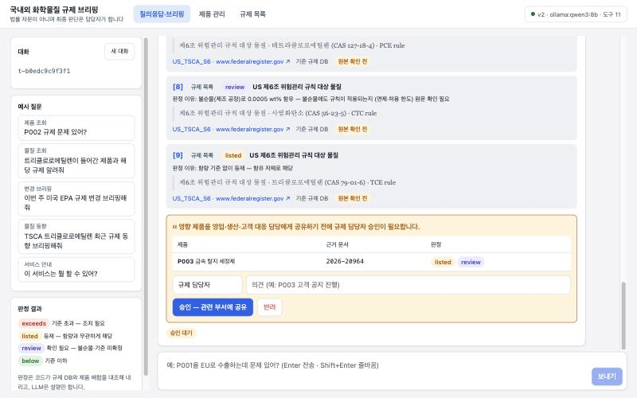
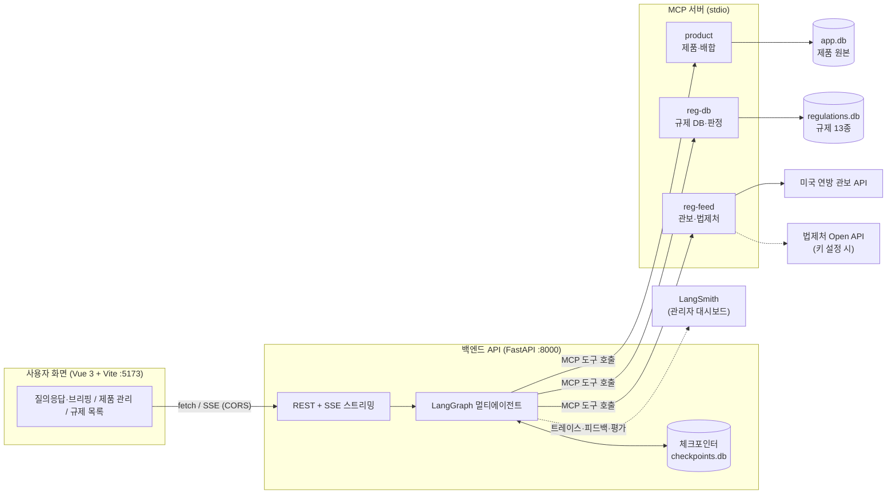
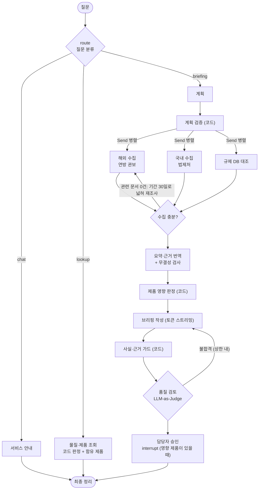

# 국내외 화학물질 규제 브리핑·영향 분석 에이전트

국내외 화학물질 규제 문서를 모아 한국어로 브리핑하고, 회사 제품 배합(CAS·함량)과 대조해 **어느 제품이 어떤 규제에 왜 해당하는지**를 근거 원문과 함께 알려 주는 멀티에이전트 서비스입니다.

> 판정은 코드가 내리고, LLM은 요약·번역·설명만 맡습니다. 법률 자문이 아니며 최종 판단은 담당자가 합니다.
> 제품 배합은 가상 데이터이고, 규제 목록 데이터는 공식 원본 대조 전(`to_verify`) 상태입니다.


## 이런 문제를 풉니다

| 담당자의 문제 | 이 서비스 |
| --- | --- |
| 국내외 공고·관보를 매주 직접 찾아 읽는다 | 미국 연방 관보 API 실시간 조회 → 회사 물질이 언급된 문서만 골라 한국어 요약 |
| 우리 제품이 해당되는지 원료 목록과 일일이 대조한다 | 제품 CAS × 규제 DB를 **코드로 판정** (수출 지역, 성형품/혼합물, 함량 기준, 그룹 합산, 불순물) |
| 번역·요약 중 숫자·CAS·날짜가 틀리면 대응이 틀어진다 | 원문과 번역의 CAS·날짜·숫자를 코드로 대조, 지어낸 사실은 가드가 차단 |
| 판단 근거를 나중에 다시 찾기 어렵다 | 답변의 `[n]`마다 원문 문장·번역·출처 URL·기준일·검증 상태 |
| 영향 제품을 확인 없이 다른 부서에 공유하면 위험하다 | 공유 전 담당자 승인(Human-in-the-loop), 서버를 재시작해도 승인 대기 유지 |

## 화면

| 브리핑 (요약 → 지역별 변경 → 제품 영향 → 할 일·기한) | 근거: 번역 + 원문 + 출처 + 기준일 |
| --- | --- |
|  |  |
| **승인: 근거를 본 뒤 영향 제품 공유 승인·반려** | **제품 관리: 배합 + 저장 즉시 규제 판정** |
|  |  |
| **규제 목록: 물질 검색 → 등재 규제·함유 제품** | |
|  | |

## 구성



### 에이전트 흐름



## 다루는 규제

| 지역 | 법 | 목록 |
| --- | --- | --- |
| 국내 | 화학물질관리법 | 유해화학물질, 허가물질, 제한물질, 금지물질 |
| 국내 | 산업안전보건법 | 특별관리물질, 관리대상유해물질 |
| 미국 | TSCA | 제6조 위험관리 규칙 대상 물질, 중요 신규 사용 규칙(SNUR) |
| EU | REACH | 고위험 우려물질(SVHC) 후보 목록, 부속서 XVII 제한 물질 |
| EU | CLP | 부속서 VI 조화된 분류 |
| 중국 | 생태환경부 고시 | 우선관리 화학물질 목록 |
| 일본 | 화학물질심사규제법 | 제1종 특정화학물질 |

## Before / After

같은 질문·같은 입력(관보 스냅샷 고정)으로 **LLM 단독(Before)**과 **에이전트(After)**를 비교했습니다. Ollama qwen3:8b, 브리핑 5문항 ([전체 결과](docs/experiments/2026-10-20-1854-ollama-qwen3-8b.md)).

| 지표 | Before (LLM 단독) | After (v2) |
| --- | --- | --- |
| 영향 제품 정밀도 | 0.357 | **0.8** |
| 무관한 제품 지목 수 | 21 | **1** |
| 지어낸 날짜 | 1 | **0** |
| 답변당 근거 수 / 근거 요건 충족률 | 0 / 0.2 | **9.8 / 1.0** (근거 49개 모두 원문 대조 통과) |
| 평균 토큰 | 8,151 | **6,395** |
| 평균 시간 | 91초 | 97초 |

- Before는 "DEHP 관련 변경 있어?"에 12개 제품 전부를 "EPA 통보가 필요할 수 있음"이라고 답했습니다. 다른 문서의 의무를 모든 성분에 갖다 붙인 것입니다.
- 날짜는 둘 다 정확했습니다. 차이는 **"어느 제품이 왜 해당하는가"**에서 납니다.
- 같은 소형 모델로 채점한 LLM-as-Judge는 위 오답에도 5점을 줬습니다. 그래서 코드 채점기를 주 지표로 씁니다.
- After의 약점: 요청한 물질과 관련된 문서가 없을 때 "없다"고 먼저 말하지 않습니다(개선 예정).

## 실행 방법

필요한 것: Python 3.11+, [uv](https://docs.astral.sh/uv/), Node.js 20.19+ (또는 22.12+). 실모델을 쓰려면 [Ollama](https://ollama.com)와 `qwen3:8b`가 필요합니다.

```bash
git clone https://github.com/ji0x0/skala-chem-reg.git
cd skala-chem-reg
uv sync
cp .env.example .env
uv run python scripts/build_reg_db.py
```

`.env`의 기본값은 `LLM_BACKEND=fake`입니다. 규칙 기반 가짜 LLM이라 키나 모델 없이 화면·API·테스트가 모두 돕니다. 실모델로 쓰려면 아래처럼 바꿉니다.

```bash
ollama pull qwen3:8b
```

```
LLM_BACKEND=ollama
```

터미널 두 개에서 백엔드와 화면을 띄웁니다.

```bash
bash scripts/run_backend.sh
```

```bash
bash scripts/run_frontend.sh
```

브라우저에서 http://127.0.0.1:5173 을 열고 예시 질문을 눌러 보세요. API 문서는 http://127.0.0.1:8000/docs 에 있습니다.

### 테스트와 평가

```bash
uv run pytest -q
```

```bash
cd frontend && npm test
```

```bash
LLM_BACKEND=ollama uv run python scripts/run_eval.py --judge
```

평가 결과는 `docs/experiments/`에 Markdown·JSON으로 저장됩니다. `.env`에 `LANGSMITH_TRACING=true`와 `LANGSMITH_API_KEY`를 넣으면 트레이스·👍/👎 피드백이 LangSmith에 남고, `--langsmith`를 붙이면 Dataset과 실험도 기록됩니다.

## API

| 메서드 | 경로 | 설명 |
| --- | --- | --- |
| POST | `/api/v1/chat/stream` | 질문 → SSE (진행·도구 호출·토큰·근거·승인 요청) |
| GET | `/api/v1/threads/{id}` | 대화 상태, 승인 대기, 근거 |
| POST | `/api/v1/threads/{id}/approval` | 승인·반려 → SSE로 이어서 실행 |
| POST | `/api/v1/feedback` | 👍/👎 → 로컬 기록 + LangSmith Run 피드백 |
| GET·POST·PUT | `/api/v1/products` | 제품 목록·추가·수정 (검증 실패 시 422 + 오류 목록, 저장 즉시 판정) |
| GET | `/api/v1/regulations`, `/api/v1/substances?q=` | 규제 목록·등재 물질, 물질 검색 |
| GET | `/api/v1/health` | 파이프라인·모델·도구 상태 |

## 기술 스택

| 영역 | 사용 |
| --- | --- |
| LLM | LangChain `init_chat_model` (Ollama qwen3:8b / OpenAI), 구조화 출력, 스트리밍 |
| 에이전트 | LangGraph — 조건 분기, `Send` 병렬 서브에이전트, 재조사 루프, `interrupt` 승인, SQLite 체크포인터 |
| 도구 | MCP 서버 3개 (FastMCP, Tool·Resource·Prompt), `langchain-mcp-adapters` |
| API | FastAPI, SSE, Pydantic, lifespan 싱글턴, CORS 허용 출처 명시 |
| 화면 | Vue 3 + Vite, `fetch` + `ReadableStream` SSE 파서, marked + DOMPurify |
| 관측·평가 | LangSmith (트레이스·피드백·Dataset·Experiment), 코드 채점기 + LLM-as-Judge |
| 데이터 | SQLite (규제 DB, 제품 DB), 미국 연방 관보 API |

## 프로젝트 구조

```
app/
  agents/        LangGraph 그래프 (v2, Before), 서브에이전트, 도구 호출 공통
  api/           FastAPI 라우터 (대화·제품·규제)
  domain/        코드 판정·CAS 검증·무결성 검사·근거 추출·물질명 매칭
  eval/          평가 채점기·실행기
  llm/           LangChain LLM 계층, 프롬프트, 구조화 출력 스키마, Fake LLM
  repositories/  규제 DB·제품 DB
  streaming/     SSE 이벤트 스키마·변환
  tools/         MCP 도구 제공자 (stdio / 메모리)
mcp_servers/     product · reg_db · reg_feed MCP 서버
frontend/        Vue 화면
data/            규제 목록·가상 제품·용어집 CSV, 관보 스냅샷, 평가 질문
scripts/         DB 빌드, 실행, 평가 스크립트
tests/           pytest (백엔드 73개)
docs/lab/        단계별 핸즈온 랩 (Step 0 → 6)
```

## 문서

- [핸즈온 랩](docs/lab/README.md): Step 0(골격)부터 Step 6(평가)까지, 단계마다 만든 파일·실행 명령·기대 결과·실제로 겪은 문제
- [주제·페인포인트·설계](docs/topic-final.md) · [요구사항](REQUIREMENTS.md) · [개발 일지](DEVLOG.md) · [트러블슈팅](troubleshooting.md)

## 한계

- 규제 목록 데이터는 공식 원본 대조 전(`to_verify`)입니다. 화면과 답변에 "원본 확인 전"으로 표시됩니다.
- 국내 실시간 조회는 법제처 Open API 키(`LAW_API_OC`)가 있어야 동작합니다. 없으면 "확인하지 못한 항목"으로 알립니다.
- 제품 배합은 가상 데이터입니다.
- 평가는 1회 측정, 소형 로컬 모델 기준입니다.
